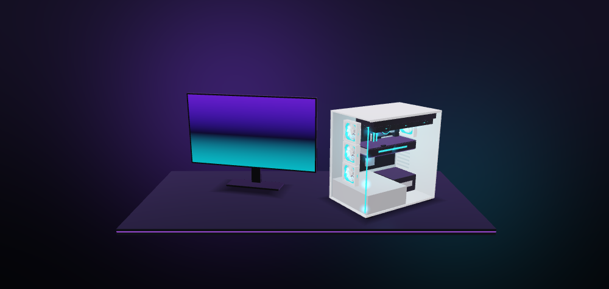
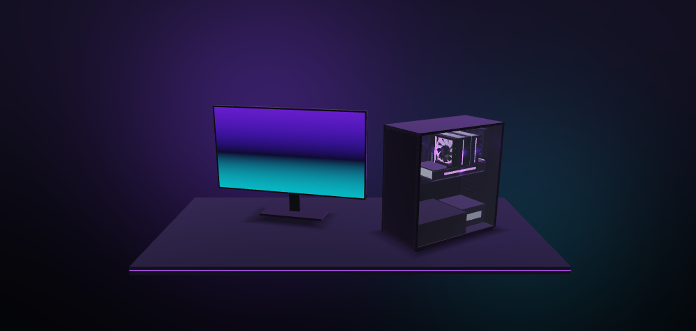
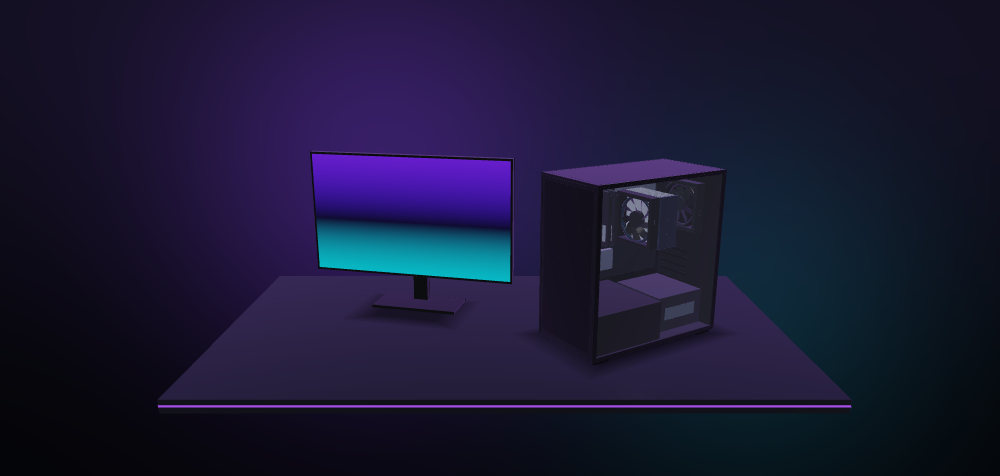

# NeoRig — конфигуратор игрового ПК с 3D-визуализацией

Android-приложение на **Kotlin + Jetpack Compose** (minSdk 26, Android 8.0+). Пользователь вводит бюджет (монитор входит в него) и пожелания. Приложение подбирает лучшую совместимую сборку из локальной базы и показывает её в 3D: корпус со стеклянной боковой стенкой, RGB-подсветка, монитор рядом.

Дизайн оригинальный: тёмная тема, неоновые фиолетовые и бирюзовые акценты. Чужих логотипов нет, бренды упоминаются только текстом.

| Белый корпус, бирюзовая подсветка | Тёмный корпус, фиолетовая подсветка | Подсветка выключена |
|---|---|---|
|  |  |  |

> Кадры отрисованы теми же GLSL-шейдерами и той же сценой, что и в приложении. Рендер сделан через WebGL2 в headless Chromium (GLSL ES 3.00 у WebGL2 и OpenGL ES 3.0 совпадает). Это не скриншоты с телефона.

---

## Возможности

- **Мастер из двух шагов.** Бюджет (ползунок с логарифмической шкалой и поле ввода, от 30 000 до 1 000 000 ₽), затем предпочтения: процессор Intel / AMD / Неважно, видеокарта NVIDIA / AMD / Intel / Неважно, назначение (игры / работа и монтаж / учёба и офис), монитор (1080p / 1440p / 4K, 60 / 144 / 240 Гц).
- **Автоподбор** за доли секунды с проверкой совместимости. Если денег не хватает, приложение показывает минимальную сумму и кнопку «Установить и собрать».
- **Экран «Сборка».** Итог, остаток, анимированная полоса бюджета с цветными сегментами по категориям, проверка совместимости, потребление и требуемый БП, 3D-превью, список деталей, оценка FPS.
- **Ручная замена любой детали** через нижнюю шторку. Несовместимые варианты отмечены красным с причиной (например, «Видеокарта длиной 340 мм, а в корпус влезает до 290 мм»), риски — жёлтым. Есть фильтр «только совместимые», сортировка и кнопка «Исправить автоматически».
- **Вкладка «3D».** Вращение пальцем с инерцией, зум щипком, двойной тап сбрасывает камеру. RGB-подсветка: включение и выключение, 8 цветов, режимы «Статика», «Радуга», «Дыхание». Вентиляторы крутятся, при замене детали она плавно «прилетает» в корпус.
- **Мои сборки (Room).** Сохранение, открытие, «Поделиться» текстом, удаление, сравнение двух сборок: детали, цены, FPS.
- **Языки:** русский и английский. Переключаются в настройках или в системной настройке «Язык приложения» на Android 13+.
- **Оценка FPS** в 8 популярных играх. Условная: считается по тиру видеокарты и процессора, разрешению и ограничениям движков.

---

## Готовый APK

Каждый push в ветку собирается на GitHub Actions (`.github/workflows/build-apk.yml`): сборка APK + юнит-тесты. Готовый файл публикуется в pre-release **neorig-latest**:
**https://github.com/daunishe1337/Claude/releases/tag/neorig-latest** — откройте ссылку на телефоне, скачайте `NeoRig-debug.apk` и установите.

---

## Как собрать APK в Android Studio

### Что понадобится

- **Android Studio** Ladybug (2024.2) или новее. Подойдёт и свежая версия: проект использует AGP 8.7.3, Gradle 8.11.1 и Kotlin 2.0.21.
- Интернет при первой синхронизации: Gradle скачает зависимости.
- Телефон на Android 8.0+ с OpenGL ES 3.0 (это практически любой телефон с 2017 года) или эмулятор.

### Шаги

1. **Скачайте проект.**
   - Через Git: `git clone <адрес репозитория>` и затем `git checkout ccr-28be3e23-ss7pnj`.
   - Или на GitHub: **Code → Download ZIP**, затем распакуйте архив.
2. **Откройте проект.** Запустите Android Studio, выберите **File → Open…** и укажите папку **`NeoRig`** (в ней лежит `settings.gradle.kts`), затем **OK** → **Trust Project**.
3. **Дождитесь синхронизации Gradle.** Прогресс виден в строке состояния внизу. Первый раз это занимает 2–10 минут: скачиваются Gradle 8.11.1 и библиотеки.
   - Если появится *«Failed to find target with hash string 'android-35'»*, откройте **Tools → SDK Manager → SDK Platforms**, отметьте **Android 15 (API 35)** и нажмите **Apply**.
   - Если Studio предложит обновить Android Gradle Plugin, можно отказаться: проект собирается на текущих версиях.
4. **Соберите APK.**
   - **Build → Build App Bundle(s) / APK(s) → Build APK(s)**.
   - В новых версиях Studio пункт называется **Build → Generate App Bundles or APKs → Generate APKs**.
   - Когда сборка закончится, справа внизу появится уведомление со ссылкой **locate**. Файл лежит здесь: `NeoRig/app/build/outputs/apk/debug/app-debug.apk`.
5. **Установите на телефон.** Выберите любой способ.
   - **Через USB (проще всего).**
     1. На телефоне откройте *Настройки → О телефоне* и 7 раз нажмите *Номер сборки*.
     2. В *Настройки → Для разработчиков* включите *Отладку по USB*.
     3. Подключите телефон кабелем и подтвердите доступ на экране телефона.
     4. В Android Studio выберите телефон в списке устройств и нажмите **Run ▶** (Shift+F10).
   - **Файлом.** Скопируйте `app-debug.apk` на телефон (кабелем, в мессенджере или через облако) и откройте его. Система попросит разрешить установку из этого источника: разрешите и нажмите *Установить*.
   - **Через adb:** `adb install -r app/build/outputs/apk/debug/app-debug.apk`.

### Из командной строки (без Studio)

```bash
cd NeoRig
./gradlew assembleDebug      # Windows: gradlew.bat assembleDebug
./gradlew test               # юнит-тесты (движок подбора, совместимость, сцена, GLB)
```

Release-APK: `./gradlew assembleRelease`. Для удобства он подписан отладочным ключом. Перед публикацией замените `signingConfig` в `app/build.gradle.kts` на свой ключ.

### Если что-то пошло не так

| Проблема | Решение |
|---|---|
| `Unsupported class file major version …` или Gradle не запускается | **Settings → Build, Execution, Deployment → Build Tools → Gradle → Gradle JDK**: выберите JDK 17 или 21 (встроенный *jbr-21* подходит) |
| `SDK location not found` | Откройте проект именно через Android Studio: она сама создаст `local.properties` с путём к SDK |
| На эмуляторе чёрный 3D-экран | В настройках AVD: *Graphics → Hardware*. Нужен образ API 26+ |
| Долгая первая синхронизация | Это нормально: скачиваются зависимости. Последующие сборки идут быстро |

---

## Архитектура

MVVM с ручным внедрением зависимостей (`AppContainer`). Доменный слой и 3D-сцена написаны на чистом Kotlin без зависимостей от Android, поэтому они покрыты обычными JVM-тестами.

```
NeoRig/
├── app/build.gradle.kts            — модуль приложения (Compose, Room+KSP, kotlinx.serialization)
├── gradle/libs.versions.toml       — версии зависимостей
├── tools/
│   ├── generate_models.py          — генератор .glb-моделей (Python 3, без зависимостей)
│   └── strings_source.py           — источник строк RU/EN → res/values*/strings.xml
└── app/src/main/
    ├── assets/db/*.json            — база деталей: 9 файлов, 132 детали
    ├── assets/models/*.glb         — 3D-модели (glTF 2.0 binary)
    ├── res/values, values-ru       — строки EN / RU, тема, иконка
    └── java/com/neorig/pcbuilder/
        ├── domain/                 — чистая логика
        │   ├── model/              — Part, PcBuild, BuildRequest, PartCatalog…
        │   ├── compat/             — CompatibilityChecker + типы проблем
        │   ├── engine/             — BuildEngine (подбор), BudgetShares, Scoring
        │   └── fps/                — FpsEstimator
        ├── data/
        │   ├── catalog/            — разбор JSON-базы
        │   ├── db/                 — Room: SavedBuildEntity, Dao, AppDatabase
        │   └── repo/               — репозитории: каталог, сохранённые сборки, настройки
        ├── render/
        │   ├── scene/              — чистый Kotlin: математика, меши, GLB-загрузчик,
        │   │                         процедурные модели, раскладка сцены, анимации, шейдеры
        │   └── gl/                 — OpenGL ES 3.0: GLSurfaceView, рендерер, жесты
        ├── ui/                     — Compose: тема, компоненты, экраны, ViewModel
        │   ├── wizard/             — «Бюджет», «Предпочтения»
        │   ├── build/              — «Сборка», шторка замены, FPS, BuilderViewModel
        │   ├── viewer/             — вкладка «3D», обёртка Pc3DView
        │   ├── saved/              — «Мои сборки», сравнение
        │   ├── settings/           — настройки
        │   └── navigation/         — NavHost и нижняя навигация
        ├── di/AppContainer.kt
        ├── NeoRigApplication.kt
        └── MainActivity.kt
```

---

## Логика подбора (`BuildEngine`)

1. **Минимальная сборка.** Сначала считается самая дешёвая совместимая сборка для выбранных предпочтений. Если бюджет меньше, пользователь видит «Бюджета не хватает» с минимальной суммой и тем, сколько добавить.
2. **Резерв на монитор** зависит от разрешения: **1080p — 15 %, 1440p — 20 %, 4K — 25 %** бюджета. Берётся лучший монитор нужного разрешения с частотой не ниже выбранной, укладывающийся в резерв. Резерв ограничен так, чтобы на системный блок точно хватило.
3. **Остаток делится по приоритетам назначения** (`BudgetShares`):

   | Назначение | Видеокарта | CPU | Плата | ОЗУ | SSD | БП | Кулер | Корпус |
   |---|---|---|---|---|---|---|---|---|
   | Игры (1440p) | **40 %** | 18 % | 10 % | 8 % | 7 % | 7 % | 4 % | 6 % |
   | Работа и монтаж | 22 % | **28 %** | 11 % | 14 % | 10 % | 6 % | 5 % | 4 % |
   | Учёба и офис | 12 % | **26 %** | 14 % | 13 % | 13 % | 8 % | 5 % | 9 % |

   В играх доля видеокарты зависит от разрешения: в 4K она больше, в 1080p больше доля процессора.
4. **Перебор процессоров.** Для каждого процессора и каждого поддерживаемого им типа памяти (LGA1700 умеет и DDR4, и DDR5) в каждой категории берётся лучшая деталь в рамках её доли. Затем:
   - если сборка вышла за бюджет, понижаются детали с наименьшей потерей «полезности» на рубль;
   - оставшиеся деньги уходят на апгрейды с наибольшим приростом. Зависимые детали подгоняются автоматически: например, более мощная видеокарта тянет за собой БП.
5. **Выбор лучшей сборки.** Из всех кандидатов берётся сборка с максимальной полезностью: это взвешенная сумма индексов производительности плюс штраф за явный дисбаланс CPU и GPU в играх. Для учёбы и офиса действуют «потолки», поэтому лишние деньги остаются в остатке, а не уходят на флагманскую видеокарту. Встроенная графика допускается только для учёбы и офиса при видеокарте «Неважно» и если она есть в процессоре.
6. **Остаток после подбора** идёт на монитор получше.

**Проверки совместимости** (`CompatibilityChecker`):

| Проверка | Что сравнивается |
|---|---|
| Сокет | сокет CPU = сокет материнской платы |
| Тип памяти | DDR4/DDR5 платы = тип модулей ОЗУ; CPU поддерживает тип памяти платы |
| Форм-фактор | ATX / mATX / ITX платы есть в списке поддерживаемых корпусом |
| Длина видеокарты | длина видеокарты ≤ максимальной длины для корпуса |
| Кулер | высота башенного кулера ≤ допустимой высоты корпуса; радиатор СЖО ≤ максимального радиатора корпуса; есть крепление под сокет |
| Блок питания | мощность БП ≥ (TDP CPU + TDP GPU + 75 Вт) × **1.3** |
| Встроенная графика | у процессора есть iGPU |
| Кулер по TDP | рассеиваемая мощность кулера ≥ TDP процессора. Это **предупреждение**, а не ошибка |

---

## 3D-визуализация

Используется вариант из ТЗ «OpenGL ES»: собственный лёгкий рендерер на **OpenGL ES 3.0** вместо SceneView/Filament. Причины:
- в APK не попадают нативные библиотеки на десятки мегабайт;
- есть полный контроль над прозрачным стеклом, RGB-ореолами и анимациями;
- нет риска сломаться при смене API SceneView (за последние версии он менялся несколько раз);
- код сцены написан на чистом Kotlin и покрыт тестами.

Как устроен рендер:
- **Освещение:** Блинн–Фонг, полусферический рассеянный свет, контровой фиолетовый свет, до 4 точечных источников (лампа в корпусе и RGB-детали), тонмаппинг ACES и гамма-коррекция, MSAA 4× (отключается в настройках).
- **Порядок отрисовки:** градиентный фон → непрозрачные детали → тени и стекло (с сортировкой от дальних к ближним и френелем) → аддитивные ореолы RGB.
- **Сцена:** корпус с прозрачной боковой стенкой; внутри материнская плата, процессор, кулер (башня или СЖО с радиатором и шлангами), планки ОЗУ, M.2-накопитель, видеокарта, БП, вентиляторы корпуса. Рядом на столе стоит монитор выбранной диагонали, изогнутые мониторы показаны изогнутыми.
- **Анимации:** при замене старая деталь уменьшается и уезжает, новая «прилетает» через стекло с лёгким перелётом и бирюзовой вспышкой. Если меняется корпус, остальные детали плавно переезжают на новые места. Первая сборка появляется каскадом.
- **Модели .glb** лежат в `assets/models`: две видеокарты, два башенных кулера, помпа СЖО, планка ОЗУ, монитор. Они сгенерированы скриптом `tools/generate_models.py`.
- **Запасной вариант.** Если у детали нет модели, файл не найден или повреждён (например, Draco-сжатие), рисуется **упрощённая геометрия** из боксов, цилиндров и колец в цветах детали. Приложение при этом не падает. Например, у однокулерных видеокарт модели нет специально, чтобы этот путь работал всегда.

### Как подключить свою модель

1. Экспортируйте модель из Blender: *File → Export → glTF 2.0*, формат **glTF Binary (.glb)**, без Draco-сжатия.
2. Соблюдайте оси детали: для видеокарты X — от платы наружу, Y — толщина вниз, Z — длина. Остальные оси описаны в начале `generate_models.py`. Масштаб не важен: модель вписывается в реальные габариты детали.
3. Назовите материалы по ролям, тогда приложение само покрасит их в цвета детали из JSON:
   - `body`, `accent` — основной и акцентный цвет;
   - `rgb` — подсветка;
   - `glass` — стекло;
   - `screen` — экран.
4. Узлы вентиляторов назовите с `spin` в имени (`spin_fan_0`): они будут вращаться вокруг своей оси Y.
5. Положите файл в `app/src/main/assets/models/` и укажите его имя в поле `visual.model` нужной детали.

---

## База деталей (`assets/db/*.json`)

9 файлов, по 11–20 позиций (всего 132): процессоры, материнские платы, видеокарты (плюс «встроенная графика»), ОЗУ, SSD, БП, кулеры, корпуса, мониторы. Пример записи:

```json
{
  "id": "gpu-rtx5070", "name": "GeForce RTX 5070 12 ГБ", "brand": "NVIDIA", "price": 59990,
  "score": 62, "workScore": 68,
  "specs":  { "vramGb": 12 },
  "compat": { "tdpW": 250, "lengthMm": 285 },
  "visual": { "color": "#1A1C21", "accent": "#84CC16", "style": "triple-fan",
              "model": "gpu_triple_fan.glb", "rgb": true }
}
```

- `specs` — характеристики для отображения.
- `compat` — параметры совместимости: `socket`, `sockets`, `memoryType(s)`, `formFactor`, `supportedFormFactors`, `tdpW`, `powerW`, `maxTdpW`, `lengthMm`, `maxGpuLengthMm`, `heightMm`, `maxCoolerHeightMm`, `radiatorMm`, `maxRadiatorMm`.
- `visual` — цвет и стиль для 3D.
- `score` и `workScore` — условные индексы производительности от 1 до 100 внутри категории (игровой и рабочий).

**Цены условные** (рубли, ориентир — рынок 2025–2026). Чтобы обновить цены, отредактируйте JSON и пересоберите приложение. Сохранённые сборки хранят только id деталей, поэтому подхватят новые цены автоматически. Корректность базы проверяет тест `CatalogTest`.

---

## Оценка FPS

`FpsEstimator`: FPS = min(предел видеокарты, предел процессора, лимит движка).
- Предел видеокарты = базовый FPS игры × (индекс GPU / 100)^0.95 × коэффициент разрешения.
- Предел процессора считается по игровому индексу CPU.

Значения ориентировочные. На экране цвет показывает уровень: красный < 30, жёлтый < 60, зелёный ≥ 60, бирюзовый — упор в частоту монитора.

---

## Проверка и тесты

В `app/src/test` лежат 35 JUnit-тестов:
- полный перебор комбинаций «бюджет × предпочтения» (сборка всегда совместима и не выходит за бюджет);
- правила совместимости;
- FPS;
- сохранение и загрузка сборок;
- раскладка 3D-сцены, загрузка всех .glb, откат на упрощённую геометрию, анимация замены, сброс камеры.

Запуск: `./gradlew test` или правой кнопкой по папке `test` → *Run Tests*.

> Полная Android-сборка (AGP 8.7.3, Room/KSP, Compose) и юнит-тесты выполняются на GitHub Actions при каждом push.
> Дополнительно 3D-шейдеры проверены рендером в WebGL2 (GLSL ES 3.00 совпадает с OpenGL ES 3.0).

---

## Товарные знаки

Названия процессоров, видеокарт и других комплектующих приведены только как текст, чтобы пользователь мог выбрать деталь. Логотипы и фирменная графика производителей не используются. Иконка, цветовая схема и 3D-модели NeoRig оригинальные.
